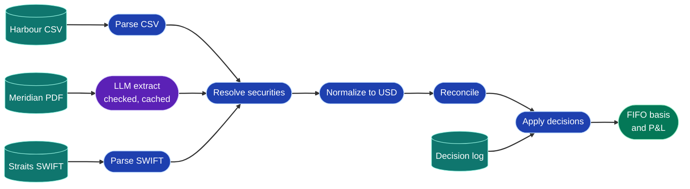
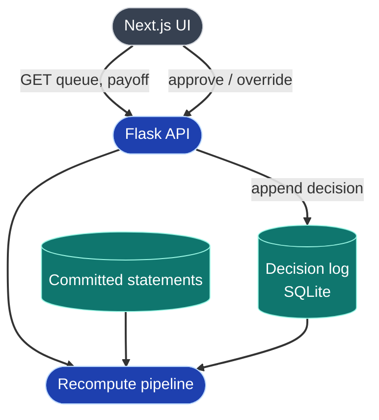

# Basis Trail

**Three banks' statements in three formats, one reconciled ledger, and a short, sourced exception queue for a human to approve.**

> All data is synthetic. The Lim family, the three banks and every quantity, price and trade are invented. No client information.

**Live demo:** <https://wealth-management-dashboard-demo.vercel.app/> · **API:** <https://wealth-management-dashboard-demo.onrender.com>/api/health

## What it does

1. Ingests a fictional family's 2023–2025 statements from three custodians: a CSV export, a PDF statement and SWIFT MT535/MT536-style messages.
2. Normalizes everything into one schema in USD, resolving three different names for the same bond to one ISIN.
3. Reconciles positions and transfers deterministically, and raises exceptions it can't safely resolve: missing cost basis, an unknown security name, a position break and an unmatched transfer.
4. Puts each exception in a queue with the exact source lines and a proposed fix. Nothing changes until a person approves or overrides it, and every decision is logged.
5. Shows the payoff: 2025 taxable gains filed account by account vs consolidated, and how much market value has no evidenced cost basis. Approving one basis carry-over cuts taxable gains from $25,242 to $13,082.

Built as a response to Canopy's article *"China's Offshore Trust Rules: It's the Books, Not the Law"*: the bottleneck is evidencing cost basis across custodians, and exceptions still need people.

## Architecture

**Pipeline** (runs in memory in about 0.15 s, from the committed files):



**Request flow:** the books are always recomputed from source; only human decisions are stored.



## Design rules

- **Reconciliation and P&L are deterministic code**, not model output. Cost basis is FIFO; basis that can't be evidenced is treated as zero cost.
- **The LLM is used once**, to extract the Meridian PDF into a strict schema. Every extracted row is checked against the page text, and the result is cached by PDF hash, so the deployed app never calls a model.
- **Exceptions are never auto-resolved.** Fuzzy name matches are suggestions; position breaks are flagged, never plugged.
- **Every number cites its source.** Each record keeps its file, page and line, so any exception can be opened at the original statement line.
- **Append-only audit log.** Approve and override write a decision with a timestamp; overrides require a note.

## The planted scenario

| Exception | What happened | Fix |
|---|---|---|
| Missing cost basis | 400 Tencent moved from Harbour to Straits in June 2024; the receipt has no cost | Carry basis across: same security, quantity and date, and the receipt names the sender |
| Unknown security name | Meridian uses the bond's full legal name; the other banks use short codes | Map to the ISIN on matching coupon and maturity |
| Position break | Meridian 2025: opening 120 + trades −40 = 80, statement shows 70 | Flag only; ask the bank for confirmations |
| Unmatched transfer | 2,000 Singtel arrive from a custodian the family doesn't hold | Stays open; basis unevidenced |

Expected 2025 figures (USD), reproduced exactly by the test suite:

| | Account by account | Consolidated | Unevidenced market value |
|---|---|---|---|
| Before approval | 25,242 | 18,562 | 17,374 |
| After the basis carry-over | 13,082 | 6,402 | 6,622 |

## Run it locally

```bash
cp .env.example .env              # repo root; CORS_ORIGINS=http://localhost:3000

# API (terminal 1), port 5001 because macOS uses 5000 for AirPlay
cd backend
python3.11 -m venv .venv && source .venv/bin/activate
pip install -r requirements.txt
python -m pipeline.run            # builds the SQLite database from data/generated/
flask --app api run --port 5001 --debug

# UI (terminal 2)
cd frontend
echo 'NEXT_PUBLIC_API_URL=http://localhost:5001' > .env.local
npm install && npm run dev        # http://localhost:3000
```

No API key is needed: the PDF extraction is read from `data/cache/`. To re-run it, set `OPENROUTER_API_KEY` in `.env` and run `python -m pipeline.parse_pdf --refresh`.

**Tests:** `cd backend && python -m pytest` (67 tests, including the full pipeline against `ground_truth.json` before and after approval).

To regenerate the synthetic data: `python -m synth.generate`.

## API

| Endpoint | Returns |
|---|---|
| `GET /api/health` | Status and the latest pipeline run with counts |
| `GET /api/exceptions` | The queue: summary, evidence, proposed fix, status |
| `POST /api/exceptions/<id>/approve` | Logs an approval |
| `POST /api/exceptions/<id>/override` | Logs an override (`{"note": "..."}` required) |
| `GET /api/payoff` | Current vs baseline figures, disposals with their FIFO lots |
| `GET /api/positions` | Year-end ledger across banks |
| `GET /api/sources?file=&page=&line=` | The cited line and its neighbours from the original file |
| `GET /api/decisions` | The audit log |
| `POST /api/reset` | Clears decisions |

## Deploy

- **API on Render** (root directory `backend`). Build: `pip install -r requirements.txt && python -m pipeline.run`. Start: `gunicorn "api:create_app()"`. Set `CORS_ORIGINS` to the Vercel URL. A restart rebuilds the database, which clears decisions.
- **UI on Vercel** (root directory `frontend`), with `NEXT_PUBLIC_API_URL` set to the Render URL.

## Layout

```
data/generated/     synthetic statements, secmaster.csv, fx_rates.csv, ground_truth.json
data/cache/         cached PDF extraction
backend/
  synth/            synthetic data generator
  pipeline/         parsers, securities master, normalize, reconcile, decisions, basis and P&L
  models/           SQLAlchemy: pipeline runs and the decision log
  api/              Flask app and endpoints
  tests/
frontend/
  app/              the single demo page
  components/       exception card, payoff panel, evidence chip and source viewer
  lib/api.ts        typed API client
```

## Limits

- No authentication; anyone with the link can approve or reset. Fine for a synthetic demo, not for client data.
- Decisions live in SQLite on the API host and reset on redeploy.
- One tax year, one base currency and FIFO only. Corporate actions are out of scope.
- The frontend has no automated tests; it was checked by hand against the API.